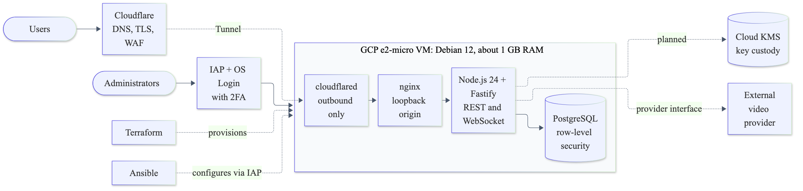

# Project Shell Space


---

## The Story

Teams that do their most valuable work (proprietary designs, unreleased ideas, creative innovation) are forced into a bad trade: convenient tools that expose their work, or private tools nobody enjoys using.

Shell Space exists to end that trade-off. It is a place where a team can think out loud, build together and share freely, knowing the walls around the room are as strong as the ideas inside it.

---

## Overview

**Project Shell Space** is a secure, privacy-focused collaboration platform built to protect high-value intellectual property, proprietary technical designs, and creative innovations.

By integrating end-to-end encryption, automated infrastructure delivery, and advanced threat telemetry, Shell Space provides teams with an isolated, resilient environment for real-time and asynchronous communication.

---

## What's Inside

| Space | Purpose |
|---|---|
| 💬 **Channels & Threads** | Real-time and asynchronous conversation, with reactions |
| 🗂️ **Kanban Boards** | Plan and track work alongside the conversation |
| 🎥 **Video Rooms** | Face-to-face collaboration without leaving the workspace |
| 🎨 **Whiteboard** | Sketch and design together, live |

---

## Key Security Features

- **Zero-Trust Access Control**: Strict identity verification and role-based policy enforcement across all communication channels.
- **End-to-End Encryption**: All endpoints communicate through encrypted tunnels, with mandatory encryption at rest and in transit.
- **Dynamic Infrastructure as Code**: Provisioned fully through version-controlled Terraform with zero hardcoded credentials or static IP bindings.
- **Telemetry & Threat Detection**: Built for continuous auditability and integration with anomaly-based detection mechanisms.

---

## Design Principles

- **Secure by default**: Least privilege, closed ports, key-only and multi-factor access, no secrets in the repository.
- **Human in the loop**: Every infrastructure and code change is reviewed and approved before it is applied.
- **Reproducible**: Infrastructure is provisioned with Terraform and configured with Ansible, so any environment can be rebuilt from the repository.

---

## Architecture at a Glance

<p align="center">
  <a href="./docs/topology/architecture.png">
    
  </a>
  <br/>
  <sub>Click the diagram to open it full size.</sub>
</p>

Users reach the platform only through a Cloudflare Tunnel, so the VM exposes no public application or SSH port. Administrators connect through IAP with OS Login and 2FA. Terraform provisions the infrastructure and Ansible configures and hardens it. More diagrams live in [`docs/topology`](./docs/topology).

---

## Tech Stack

| Layer | Technology |
|---|---|
| Frontend | React, Vite, Tailwind CSS, shadcn/ui |
| Backend services | Self-managed services |
| Infrastructure as Code | Terraform (Google Cloud) |
| Configuration management | Ansible |
| Edge | Cloudflare |
| Data | PostgreSQL |

---

## Repository Layout

| Area | Location | What lives there |
|---|---|---|
| Infrastructure | `main.tf` `variables.tf` `providers.tf` `outputs.tf` | Terraform for Google Cloud |
| Configuration | `ansible/` | Inventories, roles, playbooks and the vault template |
| Application | `src/` | React frontend |
| Diagrams | `docs/topology/` | Architecture diagrams |
| Documents | `content/` | Project documents and prompts |

```text
project-shell-space/
├── main.tf              Terraform: network, VM, KMS
├── variables.tf
├── providers.tf
├── outputs.tf
├── ansible/
│   ├── inventories/     dev, staging, prod
│   ├── roles/           common, security, data, network, compute
│   ├── playbooks/
│   └── vault/
├── src/                 React application
├── docs/topology/       Architecture diagrams
└── content/             Documents and prompts
```

---

## Contributing

**Led by Lead DevSecOps Engineer Nelson Ortiz.**

All changes land through pull requests and are reviewed before they merge.

---

## Security & Ownership

This is **proprietary work. All rights reserved.** No one may copy, reuse, redistribute, modify or use this project, in whole or in part, for personal or commercial purposes without the owner's explicit written permission.

To request permission, or for any other use, contact the repository owner, Nelson Ortiz, through his GitHub profile ([@iamnelsonnnn1-oss](https://github.com/iamnelsonnnn1-oss)).

To report a security vulnerability, do not open a public issue. Contact the owner privately in the same way.
